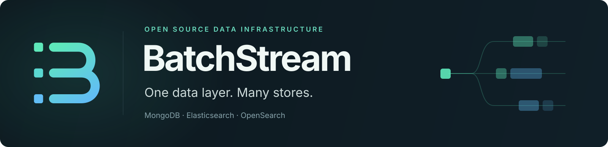

  

We build open-source data infrastructure.

**[Weir](https://github.com/batchstream/weir)** combines concurrent database requests into bounded batches for MongoDB, Elasticsearch and OpenSearch.

- [weir-go](https://github.com/batchstream/weir-go): typed Go SDK
- [weir-protocol](https://github.com/batchstream/weir-protocol): public schemas and shared validation
- [weir-charts](https://github.com/batchstream/weir-charts): Helm chart for Kubernetes
- [weir-tests](https://github.com/batchstream/weir-tests): independent integration tests and throughput comparisons

**[Gush](https://github.com/batchstream/gush)** lets Go services write durable flows and steps on Temporal as plain functions, with OTLP logs that follow the work across workers.

Archived: [Sink](https://github.com/batchstream/sink), the earlier gRPC data layer for MongoDB, Elasticsearch and OpenSearch, has been replaced by Weir.
